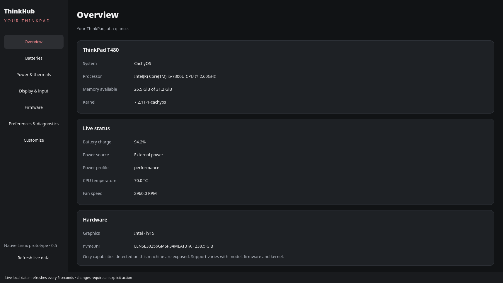
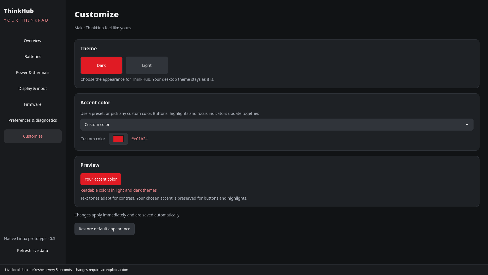

<p align="center">
  
</p>

# ThinkHub

**Your ThinkPad, at a glance.** A native Rust dashboard for monitoring and managing ThinkPad laptops on Linux.

ThinkHub brings battery health, temperatures, fan speed, hardware information and supported controls into one GTK4 app. It discovers the interfaces your laptop actually exposes and explains unavailable features or conflicts with other tools. Choose a light or dark theme and make it yours with accent colors.



**First public preview — v0.5.0-preview.1.** Tested locally on a ThinkPad T480 running CachyOS. Support depends on the model, Linux kernel, firmware and installed services. This release does **not** promise that every feature works on every ThinkPad. See the [compatibility record](docs/COMPATIBILITY.md).

## Download and install

Get a native package from **[Releases](https://github.com/marioyordanov20039-debug/ThinkHub/releases/tag/v0.5.0-preview.1)**. There are no AppImages, bundled web browsers or ThinkHub background services.

| Your distro | Download | Install from the download directory |
| --- | --- | --- |
| Ubuntu 22.04+; compatible Ubuntu-based systems | `thinkhub_0.5.0-1_ubuntu22.04_amd64.deb` | `sudo apt install ./thinkhub_0.5.0-1_ubuntu22.04_amd64.deb` |
| Debian 12+; compatible Debian-based systems | `thinkhub_0.5.0-1_debian12_amd64.deb` | `sudo apt install ./thinkhub_0.5.0-1_debian12_amd64.deb` |
| Fedora 43+; compatible Fedora-based systems | `thinkhub-0.5.0-1.fedora43.x86_64.rpm` | `sudo dnf install ./thinkhub-0.5.0-1.fedora43.x86_64.rpm` |
| Up-to-date Arch Linux, CachyOS, EndeavourOS | `thinkhub-0.5.0-1-x86_64.pkg.tar.zst` | `sudo pacman -U ./thinkhub-0.5.0-1-x86_64.pkg.tar.zst` |

These packages are for **64-bit Intel/AMD (`x86_64` / `amd64`)**. Fedora derivatives and Arch derivatives with delayed repositories may need a source build. A package's build baseline is not evidence of physical hardware testing on every derivative. ARM/32-bit binaries and official distro repositories are not available in this preview.

Open **ThinkHub** from your app launcher after installation, or run `thinkhub` as your normal user. Package installation requires administrator authorization; simply opening the dashboard does not.

**[Full installation guide](docs/INSTALL.md)** covers direct download commands, checksum verification, distro dependencies, optional fwupd/power services, source builds, upgrades, removal and troubleshooting.

## Features

- **Overview:** ThinkPad model, BIOS, CPU, memory, graphics, drives, OS and live hardware status.
- **Batteries:** single/dual batteries, charge, full/design health, cycles when exposed, energy/power readings, weighted totals and supported charging controls. Preview threshold presets or pause charging when the hardware supports it.
- **Power & thermals:** discovered temperature sensors, fan RPM, power-service profiles and holds. Firmware-auto cooling is supported where exposed.
- **Display & input:** backlight and keyboard-light controls, connector/input information and verified PS/2 TrackPoint parameters. Hyprland can also supply current output details.
- **Firmware:** allowlisted BIOS information, fwupd inventory and an experimental, guarded BIOS update preparation workflow for supported LVFS releases.
- **Preferences & diagnostics:** save preferences, inspect blockers and review change previews. Saving a preference never silently changes hardware.
- **Customize:** light/dark themes, eight accent presets and a custom color picker, remembered across launches.



No telemetry, account or cloud service is required. Normal monitoring reads local data. Firmware catalog refresh/download and explicitly requested system integrations use the relevant system services. Missing readings stay unavailable instead of being guessed.

## Controls and BIOS safety

Hardware changes require a fresh preview, validation and explicit confirmation. Privileged sysfs operations use a root-owned, version-matched helper and the system's polkit authorization dialog; the GUI stays unprivileged. Known overlapping controllers such as TLP, tuned, thinkfan or unofficial Vantage can block relevant changes. ThinkHub does not stop them automatically.

**BIOS update preparation is experimental and has not completed a physical flash/reboot validation.** It requires supported fwupd commands, trusted stable LVFS metadata, external power, sufficient battery charge, an explicit risk acknowledgement and system administrator authorization. The warning explains interruption risks and encryption recovery preparation. ThinkHub never sees or stores your password and never reboots automatically. Unsupported/older fwupd clients are blocked with an explanation. Read [BIOS_UPDATES.md](docs/BIOS_UPDATES.md) before using this feature.

Manual fan curves, BIOS editing, automatic startup/resume application, general desktop pointer settings and display-mode changes are not implemented. Detection of an interface does not guarantee that firmware will accept a write.

## Build and contribute

Requires Linux, **Rust 1.85+**, a C toolchain and GTK4 development libraries. Use the [distro-specific source-build instructions](docs/INSTALL.md#build-from-source).

```sh
cargo test --locked
cargo test --manifest-path gui/Cargo.toml --locked
cargo clippy --locked --all-targets -- -D warnings
cargo clippy --manifest-path gui/Cargo.toml --locked --all-targets -- -D warnings
cargo fmt --check
cargo fmt --manifest-path gui/Cargo.toml --check
```

CI builds native packages in Ubuntu 22.04, Debian 12, Fedora 43 and rolling Arch containers, installs them and launches the GUI under a virtual display. Synthetic tests and container smoke tests do not validate hardware writes, real desktop authorization, suspend/resume or BIOS flashing. Release verification details are in the [release checklist](docs/RELEASE.md).

Reports from more ThinkPad generations, Intel/AMD platforms and desktops are welcome. [Open an issue](https://github.com/marioyordanov20039-debug/ThinkHub/issues) with your model (without serial number), distro, kernel and what worked or failed. Review diagnostics before sharing; never post passwords, serial numbers, recovery keys or raw firmware logs. See [CONTRIBUTING.md](CONTRIBUTING.md) and [SECURITY.md](SECURITY.md).

Developer references: [architecture](docs/ARCHITECTURE.md), [backend CLI](docs/CLI.md), [GUI](docs/GUI.md), [feature limits](docs/READINESS.md) and [roadmap](docs/PLAN.md).

## License and independence

ThinkHub code and its original TH icon are available under the [MIT License](LICENSE). Third-party dependencies retain their own licenses; the app dynamically links the distro's GTK libraries. ThinkHub is an independent community project, not affiliated with or endorsed by Lenovo. ThinkPad is a Lenovo trademark.
